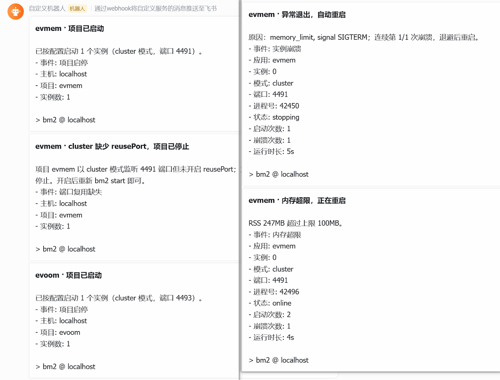

# bm2


Node.js 与 Bun 项目的进程管理器。

两个原生二进制，空闲常驻 2.6 MB，日志与告警都在里面。



## 目录

- [背景](#背景)
- [应用场景](#应用场景)
- [快速上手](#快速上手)
- [命令速查](#命令速查)
- [配置文件](#配置文件)
- [多实例与网关](#多实例与网关)
- [环境变量](#环境变量)
- [日志](#日志)
- [通知上报](#通知上报)
- [状态目录](#状态目录)
- [常见问题](#常见问题)
- [从 pm2 迁移](#从-pm2-迁移)
- [运行机制](#运行机制)
- [与 pm2 对比](#与-pm2-对比)
- [环境要求](#环境要求)
- [联系方式](#联系方式)

## 背景

Node.js 项目部署到服务器，需要一个进程管理器负责三件事。

一是应用退出后拉起，二是多实例分发，三是异常时通知到人。

常见选择是 pm2。它自己也跑在 Node.js 上，由此带来几个固定开销。

空闲常驻约 50 MB 内存；多实例之间多一层 cluster master 转发。

日志轮转要另装插件；看管进程被系统杀掉时，业务进程跟着一起停。

bm2 是 MoonBit 编译出的原生二进制，不依赖运行时，空闲常驻 2.6 MB。

多实例分发交给内核 `SO_REUSEPORT`，日志轮转与告警都在二进制内部。

看管进程崩溃或升级时，应用进程继续运行。

## 应用场景

| 场景 | 说明 |
| --- | --- |
| 一台服务器放多个项目 | 常驻开销小，装上之后基本不用维护 |
| 接口需要多实例扛并发 | 多个实例共用端口，网关侧只写一条 upstream |
| 夜间故障需要有人知道 | 崩溃、恢复、阈值越线都推到群里或邮箱 |
| 每日运行情况要留档 | 每天一份统计，逐实例列出状态与资源占用 |
| 换进程管理器不想停业务 | 升级 bm2 本身不重启应用 |

## 快速上手

### 安装

需要 MoonBit 工具链与 C 工具链，只需装一次。

```bash
curl -fsSL https://cli.moonbitlang.com/install/unix.sh | bash
moon install chensuiyi/bm2/...
```

`bm2` 与 `bm2d` 一起装进 `~/.moon/bin`。

安装时在本机编译一次；运行 bm2 不再需要工具链。

国内网络拉依赖慢时，把包下载地址换成中科大镜像，索引仍留在官方。

```json
{
  "registry": "https://mooncakes.io/",
  "download": "https://mirrors.ustc.edu.cn/mooncakes",
  "index": "https://mooncakes.io/git/index",
  "api": "https://mooncakes.io",
  "symbols": "https://mirrors.ustc.edu.cn/mooncakes/symbols.zip"
}
```

写进 `~/.moon/config.json`，文件不存在就新建。

### 写配置

在项目目录建一份 `bm2.toml`，四项即可启动。

```toml
name = "api"
script = "src/index.ts"
instances = 2
port = 3000
```

### 启动

```bash
bm2 serve        # 生产模式：登记、拉起实例、写状态
bm2 list         # 看实例表
bm2 logs api -f  # 跟随日志
bm2 dev          # 开发模式：单实例、前台跟日志
```

应用监听 bm2 分配的端口，不要写死。

```ts
const port = Number(process.env.BM2_APP_PORT)

Bun.serve({ port, reusePort: true, fetch: () => new Response("ok") })
```

`reusePort` 只在多实例共用端口时需要；`instances = 1` 时可以去掉。

## 命令速查

| 命令 | 说明 |
| --- | --- |
| `bm2 serve` | 生产模式：登记项目、拉起实例、写状态 |
| `bm2 dev` | 开发模式：单实例、前台跟随日志 |
| `bm2 dev --no-follow` | 同上，只看启动结果，不跟日志 |
| `bm2 list` | 实例表：PID、端口、状态、内存、运行时长 |
| `bm2 list <name>` | 只看某个项目 |
| `bm2 list --json` | 机器可读格式，给脚本用 |
| `bm2 check` | 只校验当前目录的 `bm2.toml`，顺带探端口 |
| `bm2 stop [name]` | 停下实例，保留登记，随时能再起 |
| `bm2 remove [name]` | 退役：停下、注销、交还名字，日志保留 |
| `bm2 remove [name] -f` | 退役并删掉状态目录与日志 |
| `bm2 logs <name>` | 看日志，`-e` 只看错误，`-f` 持续跟随 |
| `bm2 clean` | 清掉状态目录里无主的旧项目 |
| `bm2 clean --dry-run` | 只列出会删什么，不动手 |
| `bm2 reload` | 换入新的看管进程，应用继续跑 |
| `bm2 upgrade` | 升级 bm2 本身，服务不中断 |
| `bm2 notify` | 给本项目所有通知目标发一条测试消息 |
| `bm2 kill -y` | 停掉全部项目并退出看管进程 |

`stop` 是暂停，`remove` 是退役。

`[name]` 不写时，用当前目录 `bm2.toml` 里的项目。

`remove` 默认保留日志，加 `-f` 才连日志一起删。

`reload` 与 `upgrade` 都不重启应用，区别在换的是什么。

`reload` 换看管进程，改了 bm2 相关配置、或装了新运行时之后用。

`upgrade` 换 bm2 二进制本身。

## 配置文件

一份 `bm2.toml` 管一个项目，放在项目目录里。

没写出来的字段取默认值，写错字段名会被直接指出是哪一个。

### 必填四项

```toml
name = "api"          # 项目名，也是状态目录名
script = "index.js"   # 入口文件，相对 cwd
instances = 4         # 实例数
port = 3020           # 起始端口
```

### 常用字段

| 字段 | 默认 | 什么时候写 |
| --- | --- | --- |
| `cwd` | 配置文件所在目录 | 应用在别处，必须是绝对路径 |
| `runtime` | `bun` | 用 Node 就写 `"node"` |
| `exec_mode` | `cluster` | 要独立端口写 `"fork"` |
| `max_memory_mb` | 512 | 调整内存上限与告警线 |
| `max_restarts` | 10 | 调整自愈次数，`0` 是首次异常即停 |
| `restart_delay_ms` | 1000 | 调整重启间隔 |
| `min_uptime_ms` | 10000 | 活够这么久才算真的起来了 |
| `stop_timeout_ms` | 10000 | 停机时给应用的优雅退出时间 |
| `log_max_size_mb` | 10 | 单个日志文件的上限 |
| `log_keep_files` | 10 | 保留几代历史 |
| `lang` | 跟随操作者 | 钉死这个项目的输出与通知语言 |
| `[notify]` | 关闭 | 开告警与每日统计 |

`name` 会成为状态目录下的目录名，所以只允许字母开头，后面是字母、数字与下划线。

`port` 要保证最后一段端口不越界：`port + instances - 1` 不超过 65535。

### 完整示例

```toml
name = "api"                # 项目名，也是状态目录名
script = "index.js"         # 入口文件，相对 cwd
instances = 4               # 实例数
port = 3020                 # 起始端口

cwd = "/wwwroot/api"        # 默认是配置目录，应用在别处才写
runtime = "bun"             # 用 Node 写 "node"
exec_mode = "cluster"       # 要独立端口写 "fork"
max_memory_mb = 768         # 单实例内存上限，也是告警基准
max_restarts = 10           # 自愈次数，0 是首次异常即停
restart_delay_ms = 1000     # 异常退出后等多久再拉起
min_uptime_ms = 30000       # 活过这么久才算真的起来了
stop_timeout_ms = 15000     # 停机的优雅退出时间
lang = "zh"                 # 输出与通知语言

log_max_size_mb = 10        # 单个日志文件上限
log_keep_files = 10         # 保留几代历史

[notify]
enabled = true
mail_url = "smtps://smtp.example.com:465"    # 用邮箱才写
mail_from = "bm2@example.com"

[[notify.target]]
platform = "feishu"         # 也可填 email
url = "__FEISHU_WEBHOOK__"
events = ["!lifecycle"]     # 不写就收全部事件
```

凭据用 `__NAME__` 占位符，真值放 `.env` 或启动环境里。

## 多实例与网关

`instances` 大于 1 时，两种执行模式的区别只有一处：端口怎么分。

| | `cluster` | `fork` |
| --- | --- | --- |
| 端口 | 所有实例共用 `port` | 从 `port` 起连续排开 |
| 分发者 | 内核 `SO_REUSEPORT` | 网关，或没人分发 |
| 应用要求 | 必须开 `reusePort` | 无 |
| 网关写法 | 一条 upstream | 每个实例一条 upstream |
| 改实例数 | 不用动网关 | 要同步 upstream 并 reload |
| 请求落点 | 新连接按内核规则分配 | 由网关决定，可按权重与健康状态 |

`port = 3000`、`instances = 3` 时，两种模式的端口分配不同。

`cluster` 下三个实例都监听 `3000`；`fork` 下分别是 `3000`、`3001`、`3002`。

拿不准用哪个就先试 `cluster`：网关配置最省事。应用改不动、或者需要按实例单独分配端口时，换 `fork`。

两种模式都要网关才能接域名与 TLS。bm2 不管证书，也不管域名解析。

### Nginx

`cluster` 只写一条后端。

```nginx
upstream api {
    server 127.0.0.1:3000;
}

server {
    listen 80;
    server_name api.example.com;

    location / {
        proxy_pass http://api;
        proxy_set_header Host $host;
        proxy_set_header X-Real-IP $remote_addr;
        proxy_set_header X-Forwarded-For $proxy_add_x_forwarded_for;
        proxy_set_header X-Forwarded-Proto $scheme;
    }
}
```

`fork` 要把每个实例写全。

```nginx
upstream api {
    server 127.0.0.1:3000;
    server 127.0.0.1:3001;
    server 127.0.0.1:3002;
    keepalive 32;
}

server {
    listen 80;
    server_name api.example.com;

    location / {
        proxy_pass http://api;
        proxy_http_version 1.1;
        proxy_set_header Connection "";
        proxy_next_upstream error timeout http_502;
        proxy_set_header Host $host;
        proxy_set_header X-Real-IP $remote_addr;
        proxy_set_header X-Forwarded-For $proxy_add_x_forwarded_for;
        proxy_set_header X-Forwarded-Proto $scheme;
    }
}
```

### Caddy

两种模式各一行，Caddy 自动处理证书。

```text
# cluster
api.example.com {
    reverse_proxy 127.0.0.1:3000
}

# fork
api.example.com {
    reverse_proxy 127.0.0.1:3000 127.0.0.1:3001 127.0.0.1:3002
}
```

### 两种模式互相切换

`cluster` 换 `fork`：网关从一条 upstream 改成每个实例一条并 reload；应用可以去掉 `reusePort`，留着也无害。

`fork` 换 `cluster`：应用必须打开 `reusePort`；网关改回一条 upstream；端口段只保留起始端口。

## 环境变量

应用拿到的环境是一个最小集合，不是启动 `bm2` 的那个 shell 的全部。

好处是同一份配置在任何机器上跑出同一个环境；代价是 `export FOO=1` 不会跟着进应用。

### `.env` 文件

项目的变量只有一个来源：与 `bm2.toml` 并排的 `.env` 文件。

按顺序读四个文件，后者覆盖前者：

| 顺序 | 文件 | 用途 |
| --- | --- | --- |
| 1 | `.env` | 通用 |
| 2 | `.env.production` 或 `.env.development` | 按模式 |
| 3 | `.env.local` | 本机覆盖 |
| 4 | `.env.production.local` 或 `.env.development.local` | 本机覆盖且按模式 |

模式由命令决定：`bm2 serve` 是 `production`，`bm2 dev` 是 `development`。

文件不存在是正常的；存在却读不了、或格式写错，会直接报出文件与行号。

解析规则跟随 Node 生态的 `dotenv`，支持引号、跨行值、`#` 注释，`KEY=` 表示空值。

`.env` 里不做变量展开：`FOO=${BAR}` 的字面值就是 `${BAR}`。展开能力在 `bm2.toml` 的占位符上。

### 应用能拿到的变量

| 变量 | 值 |
| --- | --- |
| `BM2_APP_NAME` | 项目名 |
| `BM2_INSTANCE_ID` | 实例编号，第一个是 `"0"` |
| `BM2_APP_INSTANCE` | 同实例编号，命名对齐 pm2 的 `NODE_APP_INSTANCE` |
| `BM2_APP_PORT` | 分配给这个实例的端口 |
| `NODE_ENV` | `serve` 下是 `production`，`dev` 下是 `development` |

`BM2_APP_PORT` 随模式变化：`cluster` 下每个实例都是 `port`，`fork` 下依次递增。

`NODE_ENV` 由模式决定，`.env` 里写成别的值会被拒绝。

除保留变量与项目变量外，只有 `PATH`、`HOME`、`TMPDIR` 会传下去，以及所有以 `BM2_` 开头的变量。

`BM2_` 透传是一条实用通道：凭据只需在 shell 里 `export` 一次，应用与 `bm2.toml` 的占位符都能读到。

`PATH` 决定应用用哪个 `bun` 或 `node`，它在看管进程启动那一刻定格。换了运行时版本之后，先 `bm2 reload` 再启动项目。

## 日志

应用的标准输出与错误各一条链，所有实例合并写在一起。

### 位置

```text
~/.bm2/projects/<项目名>/logs/
├── api.log              当前普通日志
├── api.1.log            上一代，依次 .2 .3
├── api.error.log        当前错误日志
└── api.error.1.log
```

每行带时间戳与来源：`[0]` 是实例号，`[bm2]` 是 bm2 自己写的。

```text
2026-11-22T14:35:12.345Z [0] GET /api/user/profile 200 12ms
2026-11-22T14:35:12.401Z [3] TypeError: Cannot read properties of undefined
2026-11-22T14:35:13.900Z [bm2] 实例 0 pid=4021 原因=exit_code 退出码=1 重启次数=1
```

第三行是崩溃记录，写在 `api.error.log` 里，写清了退出原因与累计重启次数。

### 查看

```bash
bm2 logs api         # 普通日志
bm2 logs api -e      # 错误日志，含崩溃与重启记录
bm2 logs api -f      # 持续跟随，Ctrl+C 只停止跟随
```

也可以直接读文件。

```bash
tail -f ~/.bm2/projects/api/logs/api.log
```

### 轮转

单个文件超过 `log_max_size_mb` 就换成新的一份，旧的往后挪一代，超出 `log_keep_files` 的最旧那份删掉。

普通日志与错误日志各算各的，两条链互相不影响。

默认 `10 MiB` 与 `10` 代，单个项目最多约 `220 MB`；日志安静的项目占不满零头。

轮转只看大小、不看日期，时间覆盖因此不固定。

安静时一份 10 MB 可能很久不换，吵起来 10 代也许只够几小时。

找具体时间点靠 `grep '2026-11-22T1[0-2]'`，不依赖文件名。

想只留当前那份，把 `log_keep_files` 写成 `0`。

### 崩溃记录

崩溃记录只在异常退出或启动失败时写，人工停机不写。

`原因=` 后面是崩溃类型，常见几种在下文[常见问题](#常见问题)里逐条解释。

内存超限时会多带两个数：超限时占用的内存与上限本身。

## 通知上报

通知属于项目，写在同一份 `bm2.toml` 里。

只有两个概念：哪些事要说，说给谁听。

### 上报平台

| 平台 | `platform` | 需要的字段 |
| --- | --- | --- |
| 飞书 | `feishu` | `url`，可选 `secret` 加签 |
| 钉钉 | `dingtalk` | `url`，可选 `secret` 加签 |
| 企业微信 | `wecom` | `url` |
| Slack | `slack` | `url` |
| Discord | `discord` | `url` |
| 自定义接口 | `webhook` | `url`，可选 `secret` 作令牌 |
| 邮箱 | `email` | `to`，通道写在 `[notify]` |

邮件目标共用 `[notify]` 上的 SMTP 通道，其余平台都写 `url`。

自定义接口可选 `format` 选报文形状，默认纯文本。

```toml
[[notify.target]]
platform = "slack"
url = "__SLACK_WEBHOOK__"
format = "markdown"
events = ["crash", "errored", "memory_limit"]
```

### 事件

| 事件 | 含义 |
| --- | --- |
| `crash` | 实例崩溃，异常退出或启动失败，稍后重启 |
| `errored` | 自愈失败，重启次数用完，停下等人处理 |
| `memory_limit` | 超过 `max_memory_mb`，按异常重启 |
| `oom_kill` | 内存逼近上限时被系统杀掉 |
| `reuseport_missing` | 多实例没开 `reusePort`，项目被停 |
| `lifecycle` | 项目启停：启动、停止、退役、干净退出后重启 |
| `daemon` | 看管进程启动或换班接管项目 |
| `threshold` | 阈值告警：内存逼近、离线过久、重启过频 |
| `disk_pressure` | 状态盘剩余空间不足 |
| `start_timeout` | 拉起后端口一直没监听 |
| `daily_stats` | 每日统计 |

`events` 有三种写法，不能混用：

- 不写：收全部事件
- `events = ["crash", "oom_kill"]`：只收列出的
- `events = ["!lifecycle"]`：除了列出的都收

同一件事在 `dedupe_window_s` 内只说一次，默认一小时。

### 阈值

不写就是推荐值，写 `0` 才关闭。

| 阈值 | 默认 |
| --- | --- |
| 内存占上限 | 80% |
| 实例离线 | 5 分钟 |
| 连续重启 | 5 次 |
| 拉起后端口未监听 | 30 秒 |
| 状态盘剩余空间 | 1 G |
| 十分钟内重启次数 | 20 次 |

### 每日统计

默认每天 8 点发一份，逐实例列出状态、端口、内存、运行时长与重启次数。



不想要就在每个目标上排除 `daily_stats`：

```toml
events = ["!daily_stats"]
```

### 凭据

写在 `bm2.toml` 里的凭据用占位符，真值放 `.env` 或启动环境。

```toml
url = "__FEISHU_WEBHOOK__"     # 真值在 .env 的 FEISHU_WEBHOOK
```

smoke test 用 `bm2 notify`，它会给本项目所有目标发一条测试消息。

消息语言跟随项目 `lang`，中文项目的通知全中文。

改完配置先 `bm2 check`，它会指出字段与凭据的问题。

## 状态目录

`~/.bm2` 是 bm2 的工作目录，权限 `0700`，一个用户一份。

```text
~/.bm2/
├── daemon.endpoint           控制通道
├── bm2d.pid                  看管进程号
├── bm2d.log                  看管进程自己的输出
├── bm2d.events.log           看管事件
├── bm2.events.log            命令侧事件
└── projects/
    └── api/
        ├── project.json      登记信息
        ├── state/            每个实例的运行状态
        ├── logs/             日志
        └── .tempLogs/        应用输出的暂存
```

事件日志是排查问题的第一现场，一行一条事件。

```text
2026-11-22T12:32:19.379Z instance_exited app=worker instance=0 pid=39335 detail="exit_code=1"
```

两个事件日志与看管进程自己的输出都按相同规则轮转：`10 MiB` 一份、保留 10 代，文件名形如 `bm2d.events.1.log`。

### 四种清理动作的差别

| 命令 | 停实例 | 注销登记 | 删日志 |
| --- | --- | --- | --- |
| `bm2 stop` | 是 | 否 | 否 |
| `bm2 remove` | 是 | 是 | 否 |
| `bm2 remove -f` | 是 | 是 | 是 |
| `bm2 clean` | — | 清无主目录 | 连带删 |

`bm2 clean` 只处理没有 `project.json` 的残留目录，加 `--dry-run` 先看一眼会删什么。

一个用户一个看管进程、一份状态目录。不要把 bm2 装在 root 下替其他用户管应用；需要隔离时每个用户各装一份，互不可见。

## 常见问题

### 状态显示 errored

`errored` 不代表进程崩了，而是 bm2 停止自愈了：重启次数用完，或遇到无法自动恢复的情况。

看错误日志里的 `原因=`，对症处理之后回到项目目录 `bm2 serve`，重启预算会清零。

```bash
bm2 logs api -e
```

### 报 reuseport_missing

多实例模式要求应用打开 `reusePort`，没开就无法共用端口，bm2 会把项目停下而不是让它半死不活。

给监听加上 `reusePort: true`，或者把 `instances` 改成 `1`，或者改用 `fork` 模式。

### 报 script not found

`script` 相对 `cwd` 解析，不是相对你敲命令的目录。

`cwd` 不写时取 `bm2.toml` 所在目录，所以配置文件和应用不在同一个目录时，两个字段都要写对。

### 端口冲突

两个项目的端口段有重叠，`bm2 check` 会直接指出。

`cluster` 下所有实例共用一个端口，`fork` 占用 `port` 到 `port + instances - 1`。

### 应用起来就退出

多数是环境变量缺失或配置写错，错误日志的第一行通常就是原因。

也检查运行时可执行文件：`runtime` 按 `PATH` 解析，看管进程的 `PATH` 决定了用哪个 `bun` 或 `node`。

### 收不到通知

按顺序确认：`[notify] enabled = true`、目标写对、事件没被 `events` 排除。

再发一条测试消息，通道不通会当场报错。

```bash
bm2 notify
```

### 日志占用超出预期

`log_max_size_mb` 与 `log_keep_files` 同时决定上界：`log_max_size_mb × (log_keep_files + 1) × 2`。

默认 220 MB。日志量大的项目把这个上限调小，比事后清理省事。

## 从 pm2 迁移

三步，应用代码不用改。

1. 在项目目录写 `bm2.toml`，字段对应 `ecosystem.config.js` 里的那一组。
2. 应用里把写死的端口换成 `process.env.BM2_APP_PORT`。
3. `pm2 stop` 停旧的，再 `bm2 serve` 拉起新的。

| pm2 | bm2 |
| --- | --- |
| `pm2 start ecosystem.config.js` | 项目目录里 `bm2 serve` |
| `pm2 list` | `bm2 list` |
| `pm2 logs api` | `bm2 logs api -f` |
| `pm2 stop api` | `bm2 stop api` |
| `pm2 restart api` | 再次 `bm2 serve` |
| `pm2 delete api` | `bm2 remove api` |
| `pm2 flush` | 由轮转自动处理 |
| `pm2 startup` + `pm2 save` | 交给 systemd |

确认新方案稳定之后，再 `bm2 remove api` 清掉登记。

pm2 那边用 `pm2 stop` 而不是 `pm2 delete`，留一条退路。

## 运行机制

- `bm2` 是命令行客户端，`bm2d` 在后台看管项目
- 一份 `bm2.toml` 管一个项目，互不干扰
- 看管进程只做三件事：拉起、重启、写状态
- 应用输出先落到暂存，再合并进项目日志，守护进程崩了也不影响业务
- 看管进程退出或升级时应用继续跑，新进程读状态接管
- 状态与事件都落盘，重启后能对上原实例

停止是持久的：停止标记写在登记信息里，看管进程重启、`bm2 reload` 都不会把它带回来。

需要连接排空的应用要自己处理 `SIGTERM`：拒绝新连接、处理完进行中的请求、再退出。

## 与 pm2 对比

| 对比项 | bm2 | pm2 |
| --- | --- | --- |
| 形态 | 两个原生静态二进制 | Node.js 应用 |
| 额外依赖 | 无 | 需要 Node.js |
| 空闲看管进程内存 | 约 `2.6 MB` | 约 `50 MB` |
| 日志轮转 | 内置 | 需装 `pm2-logrotate` |
| 多实例分发 | 内核 `SO_REUSEPORT` | cluster master 进程 |
| 看管进程崩溃 | 应用继续运行 | cluster 应用随之中断 |
| 配置 | 静态 TOML，字段写错直接报 | `ecosystem.config.js` |

## 环境要求

- Linux，内核 `5.4` 及以上
- Bun `1.4.0`+，或 Node.js `24.0.0`+
- 装 bm2 需要 MoonBit 与 C 工具链，运行不需要

## 联系方式

- 仓库：https://github.com/chenbimo/bm2
- 邮箱：yicode@qq.com
