# bm2


一句话说清它是什么：**给 Bun 与 Node.js 项目用的进程管理器，两个静态二进制，自身不带运行时。**

它替你做三件事：把应用跑起来并在崩溃后拉回来，把日志收好并轮转，把异常按你配的渠道报出去。

它不做反向代理，不碰域名证书，不管开机自启，也不做远程运维。

- 官网与手册：`https://bm2.moonbitlang.dev`
- 仓库：`https://github.com/chenbimo/bm2`
- 许可：MIT



左边是控制面：你敲命令，守护进程拉起并监督实例。右边是数据面：请求经 Nginx 或 Caddy 进入，按 `cluster` 或 `fork` 打到实例端口。日志与事件向下落盘再推送出去。

## 它解决什么问题

假设你已经有一个 Bun 或 Node.js 服务，要长期跑在一台 Linux 机器上。

直接 `nohup bun index.js &` 会留下三个坑：进程挂了没人管，日志无限增长，出问题时你只能等用户告诉你。

用 `pm2` 能补上这些，但会引入新的坑：

- 守护进程自己崩了，cluster 模式下的应用跟着断，恢复时还要重建整棵进程树。
- `pm2` 本身是一个 Node.js 应用，得先有 Node.js 才能装它，再用它管别的 Node.js 应用。
- 日志轮转要额外装 `pm2-logrotate` 模块。
- 配置写在 `ecosystem.config.js` 里，那是一段可执行代码，等于把部署配置交给了运行时。

bm2 把这些坑逐个填掉，做法是把它做成两个原生静态二进制：一个命令行，一个守护进程。

守护进程崩溃时，应用继续运行，新的守护进程原地接管它们。

cluster 模式用内核的 `SO_REUSEPORT` 分发连接，没有中间层，也就没有单点。

日志轮转和异常上报都是内置的，不需要额外的模块或外部命令。

配置是一份静态 TOML，字段逐个校验，任何内容都不会被执行。

## 你能得到什么

- 崩溃自动重启，带连续重启预算。预算耗尽就停下来等你看，而不是无限重试。
- 两种多实例方式。`fork` 用连续端口交给网关分发，`cluster` 共用一个端口由内核分发。
- 守护进程崩溃不打断应用。新守护进程用 pidfd 认出原进程，校验环境后接管。
- 内置日志轮转，按项目配置大小与代数。
- 内置通知上报，支持飞书、钉钉、企业微信、Slack、Discord、通用 webhook 与邮件。
- 不停机自升级，`bm2 upgrade` 一条命令换入新版本。
- 状态与事件全部落盘，内容包括谁在跑、跑过几次、为什么退出。
- 空闲守护进程常驻内存约 `2.6 MB`，命令响应约 `1 ms`。

## 它不做什么

bm2 只做进程托管，边界很清楚。

- 反向代理、TLS、域名：交给 Nginx、Caddy。
- 开机自启：交给 systemd。
- 远程运维、集群编排、容器调度：不在范围内。
- 应用热重载：每次启动都是一次完整重启。

需要这些能力时，bm2 可以和它们并排用，不冲突。

## 环境要求

- Linux，内核 `5.3` 及以上。pidfd 进程跟踪需要它。
- `runtime = "bun"` 的项目需要 Bun `1.4.0` 及以上。
- `runtime = "node"` 的项目需要 Node.js `24.0.0` 及以上。
- 只要在安装与升级 bm2 时需要 MoonBit 工具链，运行 bm2 不需要。

版本下限在启动那一刻实测。低于下限会直接拒绝启动并说清缺什么，而不是让实例反复崩溃给你看。

## 安装 bm2

```bash
curl -fsSL https://cli.moonbitlang.com/install/unix.sh | bash
moon install chensuiyi/bm2/...
```

`bm2` 与 `bm2d` 会一起装进 `~/.moon/bin`，不需要再配 `PATH`。

## 快速开始

在项目目录里写一份 `bm2.toml`。

```toml
name = "api"
script = "src/index.ts"
instances = 2
port = 3000
```

然后在这个目录执行：

```bash
bm2 serve        # 生产模式启动并登记
bm2 list         # 看实例表
bm2 dev          # 开发模式，单实例，前台跟随日志
```

应用里这样监听端口。

```ts
Bun.serve({
  port: Number(Bun.env.BM2_APP_PORT),
  reusePort: true,
  fetch: () => new Response('ok'),
})
```

`reusePort: true` 只在 `cluster` 模式下需要。忘了写的后果很明确：bm2 启动后实测到没有生效，会停下整个项目并告诉你原因，而不是让第二个实例随机发疯。

## 命令速查

| 命令 | 用途 |
| --- | --- |
| `bm2 serve` | 生产模式：登记、启动、写状态 |
| `bm2 dev` | 开发模式：单实例，前台跟随日志，`--no-follow` 可关闭跟随 |
| `bm2 stop <name>` | 停下，但保留登记，随时可以再起来 |
| `bm2 remove <name>` | 退役：停下、注销、交还名字，日志默认保留 |
| `bm2 remove <name> -f` | 退役并删除它的状态目录，连日志一起 |
| `bm2 clean` | 清掉状态目录里已经没有归属的旧目录，`--dry-run` 只看不删 |
| `bm2 list [name]` | 查看实例表，`--json` 给机器读 |
| `bm2 check` | 只校验当前目录的 `bm2.toml`，不碰守护进程 |
| `bm2 reload` | 换入新的守护进程，应用继续运行 |
| `bm2 notify [target]` | 给本项目的通知目标发一条测试消息 |
| `bm2 upgrade` | 用 `moon install` 换入新版本并让新守护进程接管 |
| `bm2 kill -y` | 停掉全部项目并退出守护进程 |

`stop` 与 `remove` 的分工值得记一下。`stop` 是暂停，名字还在册。`remove` 是退役，名字交还出去，但日志留着，因为想翻日志的时刻往往在项目消失之后。

## 配置速查

```toml
name = "api"                  # 项目名，也是状态目录下的目录名
cwd = "/srv/api"              # 默认是 bm2.toml 所在目录
script = "src/index.ts"       # 相对 cwd
runtime = "bun"               # bun 或 node
exec_mode = "cluster"         # cluster 或 fork
instances = 2
port = 3000
max_memory_mb = 512
max_restarts = 10             # 连续异常重启预算，0 表示首次异常即停止自愈
restart_delay_ms = 1000
min_uptime_ms = 10000
stop_timeout_ms = 10000

[logs]
max_size_mb = 10
keep = 0                      # 0 表示归档代数不限

[notify]
enabled = false
```

完整字段、约束与占位符写法见[配置手册](docs/guide/configuration.md)。

## 运维要点

**每次启动都是完整重启。** 改了实例数、端口或脚本，在下一次 `bm2 serve` 时生效。

**停止是持久的。** `bm2 stop` 之后，守护进程重启或 `bm2 reload` 都不会把它偷偷带回来，只有你再次 `bm2 serve` 才会。

**装了新运行时之后要换班。** 守护进程的 `PATH` 在它启动那一刻定格，装了新版 Bun 或 Node.js 后先 `bm2 reload`，再用到它的项目才能看到。

**升级不需要停应用。** `bm2 upgrade` 查最新版本、用 `moon install` 换入二进制，然后让新守护进程接管，整个过程应用照常服务。

## 上线前值得确认

- 端口不冲突。所有在册项目的端口范围互不重叠，冲突时 bm2 会点名占用的项目。
- `cluster` 模式开了 `reusePort`。
- `max_memory_mb` 与机器内存匹配。超限按异常重启处理，不是静默杀掉。
- 通知里的凭据用 `__NAME__` 占位符，真值放在 `.env` 或启动时的环境变量里，别写进仓库。
- 反向代理只指一个端口：`cluster` 只要一条 upstream，`fork` 要给每个实例一条。

## 与 pm2 的对比

| 对比项 | bm2 | pm2 |
| --- | --- | --- |
| 形态 | 两个原生静态二进制 | Node.js 应用 |
| 额外依赖 | 无 | 需要 Node.js |
| 空闲守护进程内存 | 约 `2.6 MB` | 约 `50 MB` |
| 日志轮转 | 内置 | 需装 `pm2-logrotate` |
| cluster 分发层 | 内核 `SO_REUSEPORT`，无中间层 | cluster master 进程 |
| 守护进程崩溃 | 应用继续运行，新守护进程接管 | cluster 应用随之中断 |
| 配置 | 静态 TOML，字段强校验 | `ecosystem.config.js`，可执行代码 |
| 环境变量 | 白名单 + 保留变量显式注入 | 继承调用方 shell 的完整环境 |

完整对比与实测数据在[文档首页](docs/index.md)。

## 文档

手册在 `docs/` 下，可以直接读 Markdown，也可以本地起站点。

```bash
cd docs && bun install && bun run dev
```

| 主题 | 位置 |
| --- | --- |
| 安装与升级 bm2 | [docs/guide/install.md](docs/guide/install.md) |
| 十五分钟上手 | [docs/guide/quickstart.md](docs/guide/quickstart.md) |
| 配置参考 | [docs/guide/configuration.md](docs/guide/configuration.md) |
| 环境变量 | [docs/guide/environment.md](docs/guide/environment.md) |
| 状态与日志 | [docs/guide/state-and-logs.md](docs/guide/state-and-logs.md) |
| 两种模式怎么选 | [docs/guide/load-balancing.md](docs/guide/load-balancing.md) |
| cluster 模式 | [docs/guide/mode-cluster.md](docs/guide/mode-cluster.md) |
| fork 模式 | [docs/guide/mode-fork.md](docs/guide/mode-fork.md) |
| 命令参考 | [docs/guide/commands.md](docs/guide/commands.md) |
| 通知 | [docs/guide/notifications.md](docs/guide/notifications.md) |
| 排障与常见问题 | [docs/guide/troubleshooting.md](docs/guide/troubleshooting.md) |
| 从 pm2 迁移 | [docs/guide/migration-from-pm2.md](docs/guide/migration-from-pm2.md) |
| 能力总览 | [docs/guide/features.md](docs/guide/features.md) |

文档目前只有中文。英文版等实现稳定之后再补，同时维护两份必然漂移。
